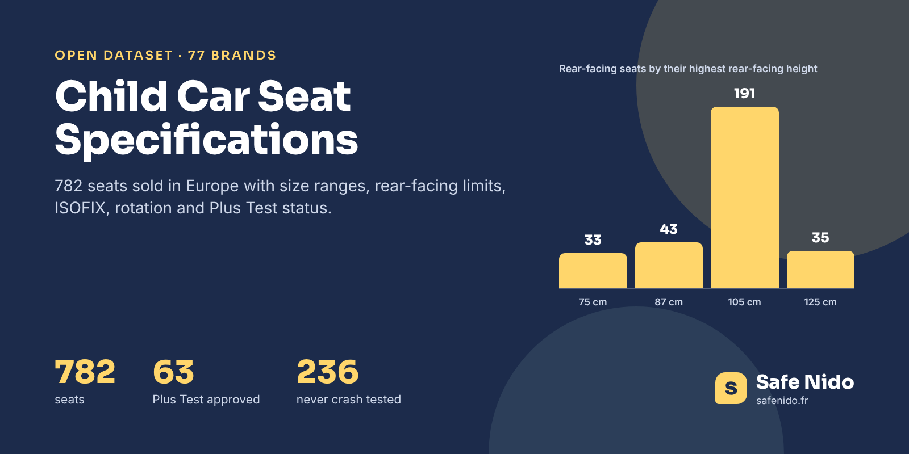

# Child Car Seat Specifications Europe



[](https://doi.org/10.5281/zenodo.24154408) [](https://www.kaggle.com/datasets/safenido/child-car-seat-specifications-europe) [](https://huggingface.co/datasets/safenido/child-car-seat-specs) [](https://creativecommons.org/licenses/by/4.0/) [](https://www.safenido.fr/)

**English first, version française plus bas.**

What height is a car seat approved for, until when can it stay rear-facing, does it rotate, how heavy is it? This dataset answers those questions for **782 child car seats from 77 brands** sold in Europe, from infant carriers to backless boosters, with the manufacturer page or manual each value was read from.

It also says which seats passed the Swedish **Plus Test**, the strictest rear-facing test in the world, and which seats have **no independent crash test published** at all, which is the case for 236 of them.

### The Headline Numbers

|  |  |
|---|---|
| Seats | 782 |
| Brands | 77 |
| Approved under R129 (i-Size) | 491 |
| Passed the Swedish Plus Test | 63 |
| Rotating seats | 224 |
| Rear-facing beyond 105 cm | 36 |
| No published independent crash test | 236 |
| Median seat weight | 7.1 kg |

Most rear-facing seats stop at 105 cm, the minimum R129 asks for. Only 36 seats stay rear-facing beyond, up to 125 cm, roughly the height of a child of 6 or 7. Almost a third of the seats listed have never been through an independent crash test, so their only guarantee is the regulatory approval.

### Files

| file | content |
|---|---|
| `data/child_car_seat_specs.csv` | 782 rows, one per seat model |
| `images/cover.png` | Cover image, 1600 × 800 |

### Columns

**child_car_seat_specs.csv**

| column | description |
|---|---|
| `seat_id` | Safe Nido identifier |
| `brand, model` | Brand and commercial name |
| `seat_type` | infant_carrier, rotating_or_reversible, rear_facing_only, harness_to_booster, high_back_booster... |
| `regulation` | R129 (i-Size) or R44 |
| `child_height_min_cm, child_height_max_cm` | Approved child height |
| `child_weight_min_kg, child_weight_max_kg` | Approved child weight, when stated |
| `age_min_months, age_max_months` | Indicative age range given by the brand |
| `rear_facing, rear_facing_min_cm, rear_facing_max_cm` | Rear-facing use and its height range |
| `forward_facing, forward_facing_min_cm, forward_facing_max_cm, forward_facing_min_months` | Forward-facing use |
| `isofix` | ISOFIX attachment |
| `rotation, rotation_deg` | Rotating seat and angle |
| `seat_weight_kg, base_weight_kg` | Weights |
| `newborn_insert, headrest_positions, recline_positions, removable_cover, side_protection` | Features |
| `plus_test_approved, plus_test_number, plus_test_limit` | Swedish VTI Plus Test |
| `independent_crash_test_published` | True when ADAC or ÖAMTC published a test of the seat |
| `sources` | Pages the values were read from |
| `safenido_url` | Seat page on Safe Nido |

### Load It

```python
import pandas as pd

base = "https://raw.githubusercontent.com/safenido/child-car-seat-specs/main"
df = pd.read_csv(f"{base}/data/child_car_seat_specs.csv")
df[df.rear_facing_max_cm > 105][["brand", "model", "rear_facing_max_cm", "plus_test_approved"]]
```

### How It Was Built

Values were read between September and November 2026 from manufacturer pages and manuals first, then retailer pages when the brand gave nothing, and every value keeps its source in the Safe Nido database. Plus Test status comes from the official VTI list. Empty cells mean the value was not found, nothing was guessed.

### Checked Against The Source

The Plus Test seats were matched to the official VTI list number by number. When a manual and a retailer disagree, the manual wins.

### Read With Care

- **Coverage varies by field.** Height range is known for about 70% of seats, recline positions for a third.
- **Age is indicative.** Regulations use height (R129) or weight (R44), not age.
- **Not a car compatibility list.** Whether a seat fits a given car depends on the vehicle list of the seat maker.

### License And Citation

**[CC BY 4.0](https://creativecommons.org/licenses/by/4.0/)**. Use it, share it and adapt it, commercially or not, and credit **Safe Nido** with a link to **[safenido.fr](https://www.safenido.fr/)**, along with the original source below.

```bibtex
@misc{safenido_child_car_seat_specs_2026,
  title  = {Child Car Seat Specifications Europe},
  author = {{Safe Nido}},
  year   = {2026},
  doi    = {10.5281/zenodo.24154408},
  url    = {https://github.com/safenido/child-car-seat-specs},
  note   = {Dataset, version 1.0}
}
```

Source. Manufacturer websites and manuals, retailer pages and the VTI Plus Test list, compiled by Safe Nido, https://www.safenido.fr/sieges-auto/

Archived on **[Zenodo](https://doi.org/10.5281/zenodo.24154408)** with a permanent DOI, 10.5281/zenodo.24154408.

Companion datasets, **[Child Car Seat Crash Test Statistics 2007-2026](https://github.com/safenido/child-car-seat-crash-test-statistics)** ([Kaggle](https://www.kaggle.com/datasets/safenido/child-car-seat-crash-test-statistics-2007-2026), [Hugging Face](https://huggingface.co/datasets/safenido/child-car-seat-crash-test-statistics)), **[Child Car Seat Recalls Europe 2016-2026](https://github.com/safenido/child-car-seat-recalls-europe)** ([Kaggle](https://www.kaggle.com/datasets/safenido/child-car-seat-recalls-europe-2016-2026), [Hugging Face](https://huggingface.co/datasets/safenido/child-car-seat-recalls-europe)). All Safe Nido datasets are listed in **[Child Passenger Safety Datasets](https://github.com/safenido/child-passenger-safety-datasets)**.

Also on **[GitHub](https://github.com/safenido/child-car-seat-specs)**, **[Kaggle](https://www.kaggle.com/datasets/safenido/child-car-seat-specifications-europe)** with a starter notebook, and **[Hugging Face](https://huggingface.co/datasets/safenido/child-car-seat-specs)**, ready for the `datasets` library.

### On Safe Nido

The data behind these files is used on [Safe Nido](https://www.safenido.fr/), an independent French guide to child car seats built on twenty years of crash tests.

- [Compare child car seats](https://www.safenido.fr/comparer/)
- [All car seats](https://www.safenido.fr/sieges-auto/)
- [Plus Test seats](https://www.safenido.fr/plus-test/)
- [Seats with no crash test](https://www.safenido.fr/guides/barometre-sieges-auto-sans-crash-test/)

---

## Version Française

### 782 Sièges Auto Et Leurs Caractéristiques

782 sièges auto vendus en Europe, de 77 marques, avec la taille et le poids homologués, la limite dos à la route, l'ISOFIX, la rotation, le poids du siège et la validation au Plus Test suédois. Chaque valeur garde la page de la marque ou la notice où elle a été lue.

- 63 sièges ont passé le Plus Test.
- 36 sièges restent dos à la route au-delà de 105 cm.
- 236 sièges n'ont aucun crash-test indépendant publié.

Licence CC BY 4.0, en citant **Safe Nido** et un lien vers **[safenido.fr](https://www.safenido.fr/)**. Retrouvez les guides et les fiches des sièges sur [Safe Nido](https://www.safenido.fr/).
